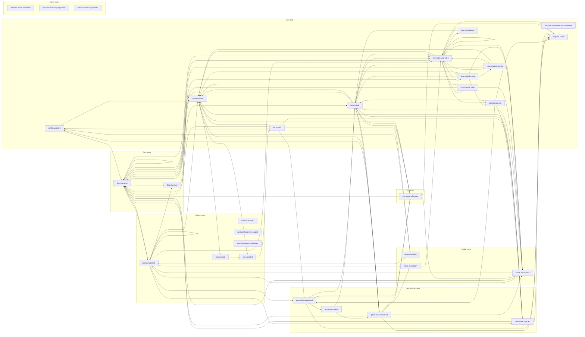

<!-- Generated from packages/schema/schemas/event-flow.json by packages/schema/scripts/generate.ts. Do not edit. -->

# Event flow

Each arrow is a declared edge: an event of the arrow's target type may follow one of its source type in a session log (Q68(b)). The e2e tests check that every observed pair in their logs is declared.

